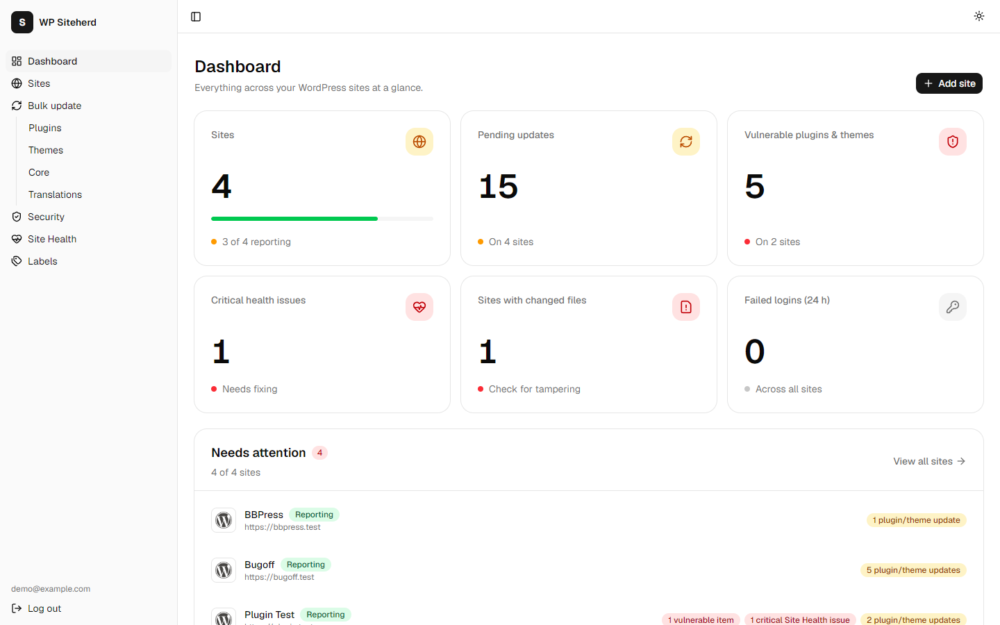
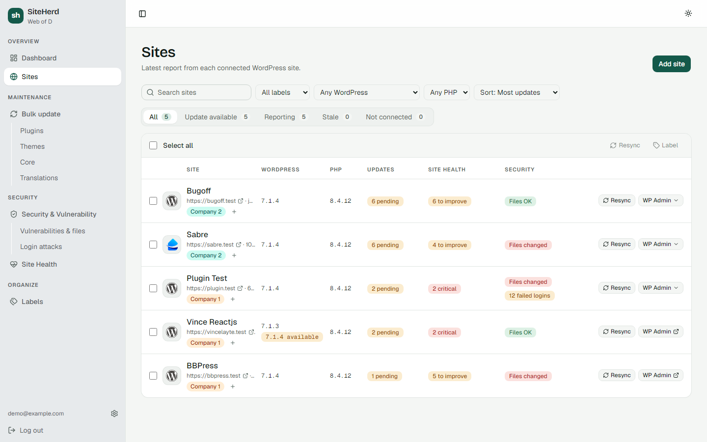
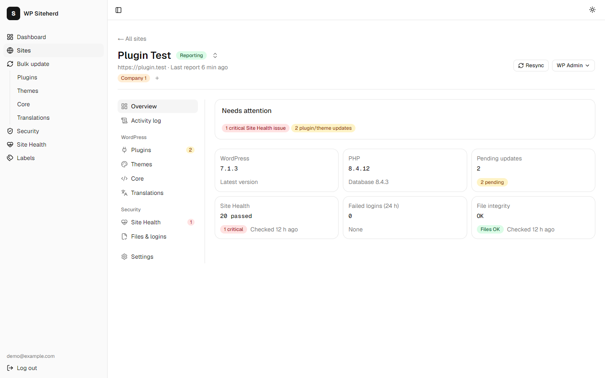
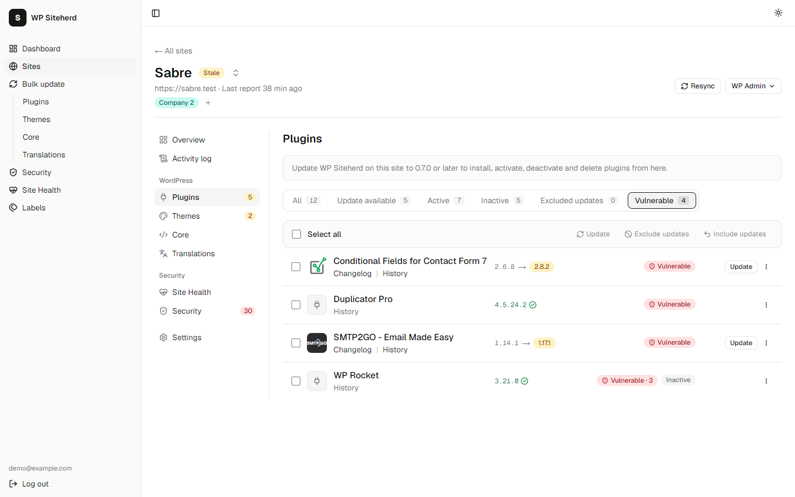
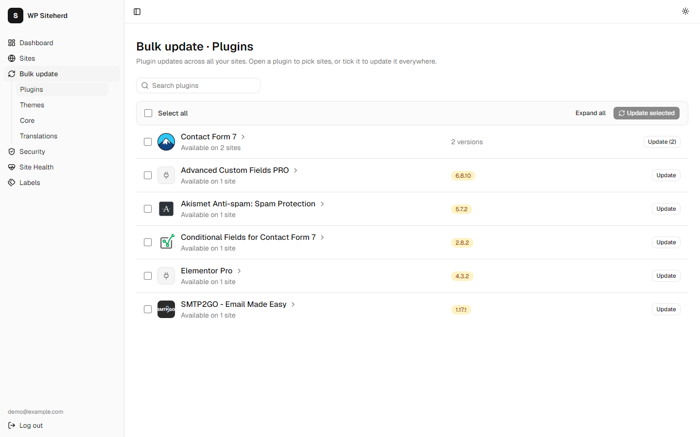
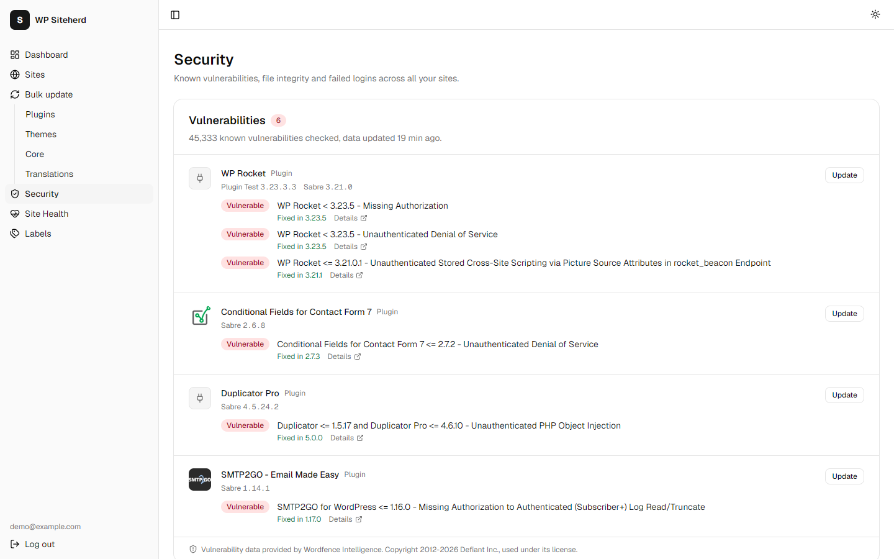
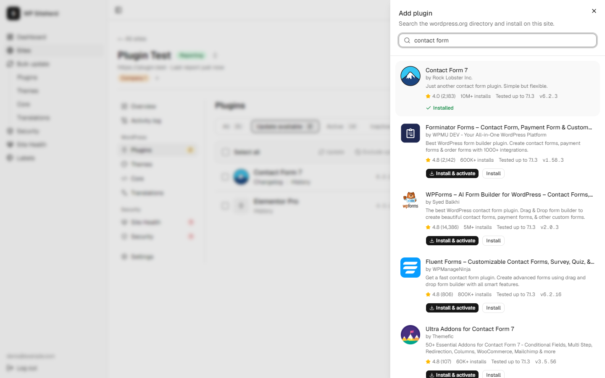
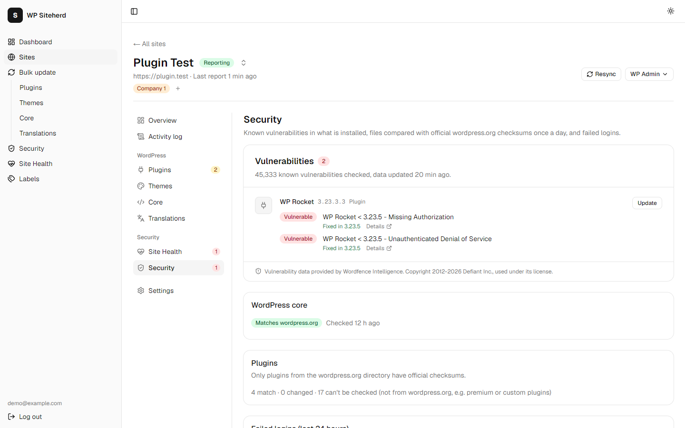
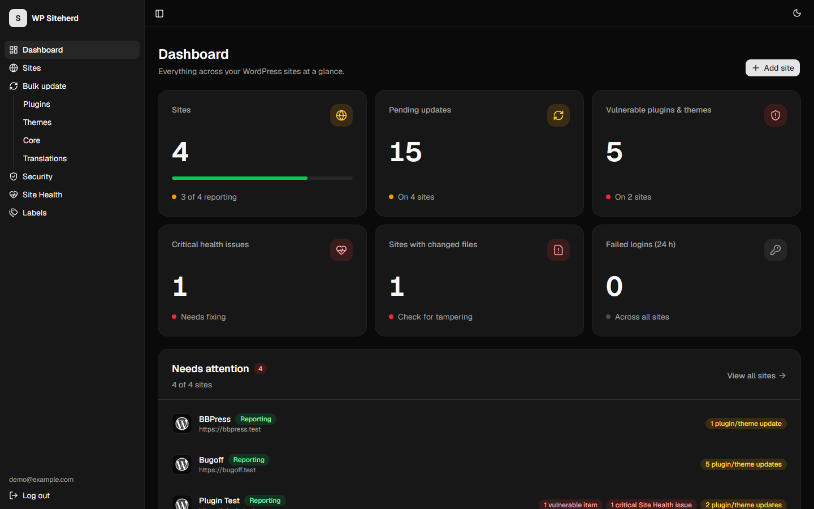

# WP Siteherd: Dashboard

One dashboard to watch and maintain all of your WordPress client sites. It shows versions, pending updates, known vulnerabilities, Site Health, file integrity and failed logins for every site, and lets you update, roll back, install or remove plugins, or log in to wp-admin with one click.

It's built for agencies and freelancers. Each site runs the companion plugin, **[wp-siteherd](https://github.com/slightgrey/wp-siteherd)**, which reports to this dashboard over signed HTTPS requests.



## Features

- **Fleet overview:** totals across all sites and a "needs attention" list (vulnerable plugins, critical health issues, changed files, pending updates, sites that stopped reporting).
- **Vulnerability detection:** every installed plugin, theme and WordPress version is matched against the [Wordfence Intelligence](https://www.wordfence.com/threat-intel/) vulnerability database (refreshed daily), with the fixed version and a link to each record.
- **Sites list:** search, filter by label, WordPress or PHP version, sort by number of updates, and resync or label sites in bulk.
- **Per-site pages:** overview, activity log, plugins, themes, core, translations, Site Health, files & logins, and settings.
- **Remote updates:** update plugins, themes, core and translations from the dashboard. Each plugin or theme is backed up first. The site is health-checked afterwards and restored automatically if the update broke it. Jobs are queued per site.
- **Bulk update:** every pending plugin, theme, core and translation update across all sites, grouped by item. Update it everywhere, or pick sites.
- **Rollback:** go back to the version kept from the last update, or to an earlier wordpress.org release.
- **Plugin management:** search wordpress.org and install a plugin on a site (optionally activating it), and activate, deactivate or delete plugins, one at a time or in bulk. Activation is health-checked: if the site stops loading, the plugin is deactivated again.
- **Update exclusions:** pin a plugin, theme or core on a site so it never counts as pending.
- **Edited-plugin protection:** plugins whose files differ from wordpress.org are flagged, and updating them requires confirmation.
- **One-click login:** open wp-admin on any site from a signed, single-use link.
- **Labels:** group sites by client or agency.
- **Light, dark and system themes.**

## Screenshots

| | |
|---|---|
|  |  |
| **Sites:** filters, labels, bulk actions | **Site overview** |
|  |  |
| **Plugins:** vulnerable filter, update, rollback, activate, delete | **Bulk update** across sites |
|  |  |
| **Vulnerabilities** across all sites | **Add plugin** from wordpress.org |
|  |  |
| **Site security:** vulnerabilities, file integrity, failed logins | **Dark mode** |

## Stack

- [Next.js](https://nextjs.org) 16 (App Router, Cache Components), React 19, TypeScript
- [Auth.js](https://authjs.dev) v5: email + password with scrypt hashes and JWT sessions
- PostgreSQL with [Drizzle ORM](https://orm.drizzle.team)
- Tailwind CSS + [shadcn/ui](https://ui.shadcn.com)
- Vitest

## Getting started

Requirements: Node.js 20+ and Docker (for the local Postgres).

```bash
npm install
cp .env.example .env.local     # then fill in AUTH_SECRET (npx auth secret)
npm run db:up                  # start Postgres in Docker
npm run db:migrate             # create the tables
npm run dev                    # http://localhost:3000
```

Sign up at `/signup`, add a site, and copy its **connection key** into the plugin's settings page (Settings → WP Siteherd) on that WordPress site.

### Environment variables

| Variable | Purpose |
|---|---|
| `DATABASE_URL` | Postgres connection string |
| `APP_URL` | Public URL of the dashboard. It's built into every connection key, so the WordPress sites must be able to reach it. |
| `AUTH_SECRET` | Session encryption key (`npx auth secret`) |
| `WORDFENCE_API_KEY` | Optional: turns on vulnerability detection. Get a free key at wordfence.com → Account → Integrations. |
| `SITE_CA_FILE` | Optional, development only: an extra CA certificate for sites with self-signed HTTPS |

### Scripts

| Command | |
|---|---|
| `npm run dev` / `build` / `start` | Develop, build, and run in production |
| `npm run lint`, `npx tsc --noEmit` | Lint and type-check |
| `npm test` | Unit tests (Vitest) |
| `npm run db:generate` | Create a migration after editing `src/db/schema.ts` |
| `npm run db:migrate` | Apply migrations from `drizzle/` |
| `npm run db:studio` | Browse the database |
| `npm run report:test -- <connection key>` | Send a signed sample report, without needing a WordPress site |
| `npm run vulns:sync` | Download the vulnerability database now (it otherwise refreshes itself once a day) |

## How sites connect

1. Adding a site generates a **site ID** and a **secret**. They are given to the plugin as a connection key: `siteherd1_` + base64url(JSON `{url, id, secret}`).
2. Every 10 minutes, and about 30 s after any plugin, theme or core change, the plugin `POST`s a report to `/api/sites/report`. Reports are parsed leniently, so sites running older plugin versions keep working.
3. The dashboard calls the plugin's REST endpoints (`/wp-json/siteherd/v1/…`) for updates, rollbacks, plugin installs and removals, and resyncs. Installing, activating, deactivating and deleting plugins needs plugin 0.7.0 or later. The plugin pushes progress back to `/api/sites/update-result`.

### Request signing

Every request in both directions is signed with HMAC-SHA256 using the site's secret.

- Headers: `X-Siteherd-Site`, `X-Siteherd-Timestamp`, `X-Siteherd-Signature`
- Signed string: `"{timestamp}.{raw body}"`. The timestamp is in Unix seconds, and the body is empty for GET.
- Signature: lowercase hex
- The signature is verified against the raw body before JSON parsing, using a constant-time comparison.
- Timestamps older than 5 minutes are rejected, and a signature can't be used twice.
- Every auth failure returns the same `401 unauthorized`.

The implementation lives in `src/lib/hmac.ts`. The plugin's `Siteherd_Signer` mirrors it, and both test suites share the same test vectors.

## Project layout

```
src/
  app/(auth)/        login, signup
  app/(app)/         logged-in pages: dashboard, sites, bulk update, security, health, labels
  app/api/sites/     report and update-result endpoints (called by the plugin)
  db/schema.ts       Drizzle schema
  lib/               signing, reports, updates/queue, rollback, labels, SSO, …
scripts/             send-test-report
drizzle/             migrations
```

## Vulnerability data

Vulnerability data is provided by [Wordfence Intelligence](https://www.wordfence.com/threat-intel/). Copyright 2012-2026 Defiant Inc., used under the [Wordfence Intelligence Terms and Conditions](https://www.wordfence.com/wordfence-intelligence-terms-and-conditions/). The dashboard links each finding to its record, as the license requires.

## License

GPL-3.0. See [LICENSE](LICENSE).
